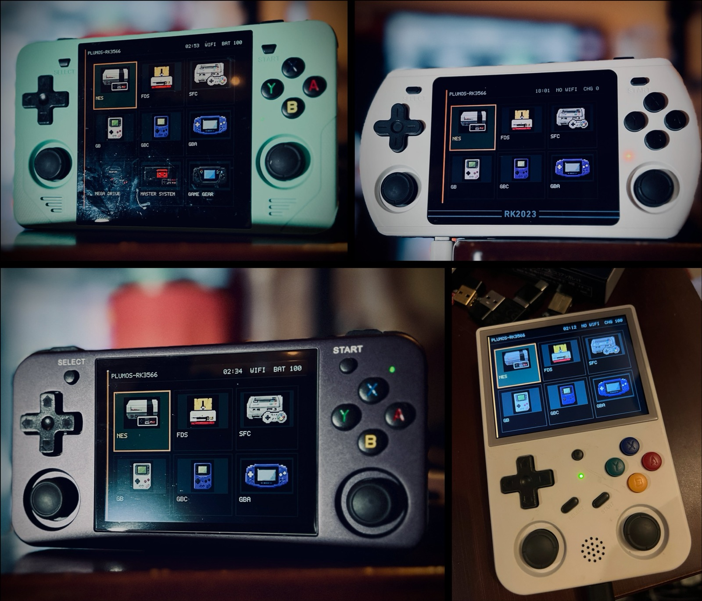
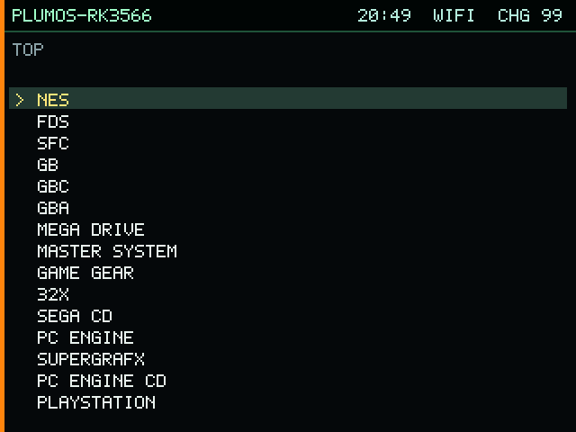
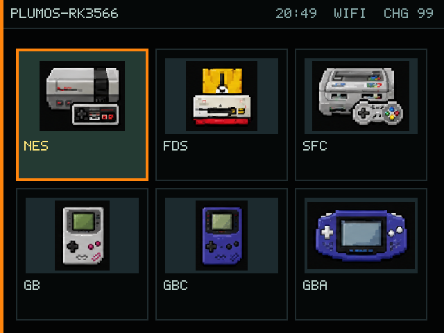
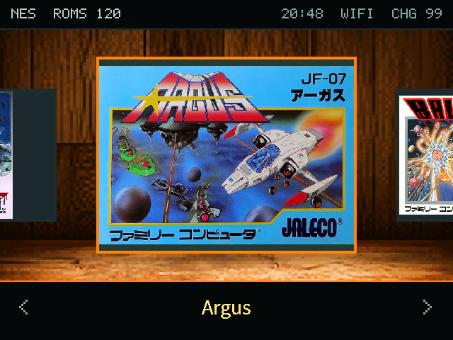

  

  

| テキストモード | グラフィックモード | ギャラリーモード |
| :---: | :---: | :---: |
|  |  |  |

# plumOS-RK3566

plumOS-RK3566は、RK3566携帯ゲーム機向けのSD起動Linuxです。共通イメージで、実機確認済みのAnbernic・Powkiddy機種にフロントエンド（FE）、RetroArch、PicoArch、単体エミュレータを提供します。

## ドキュメント

- [ユーザーガイド](docs/user/README.ja.md)
- [開発者ガイド](docs/developer/README.ja.md)
- [MITライセンス](LICENSE) · [第三者ライセンス](THIRD_PARTY_NOTICES.ja.md)
- [English](README.md)
