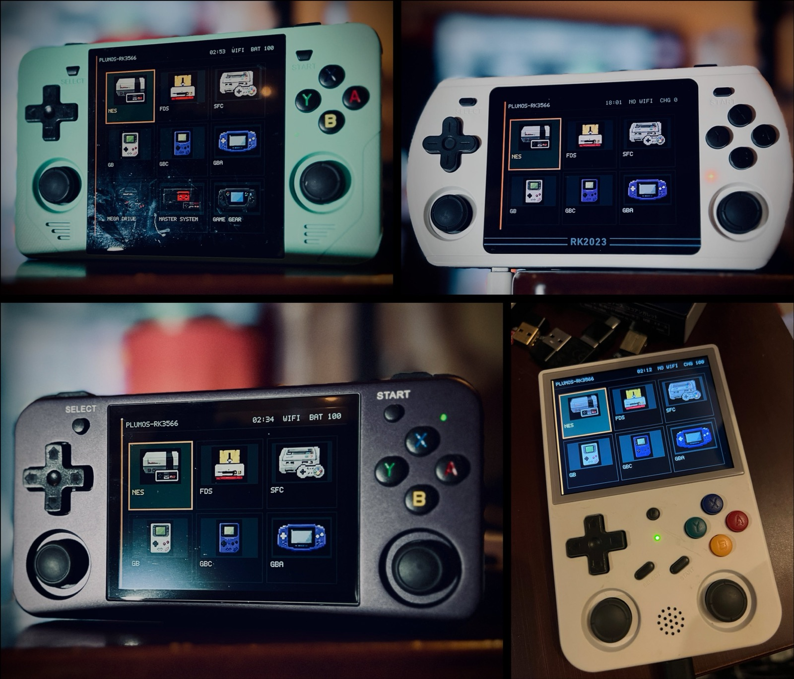
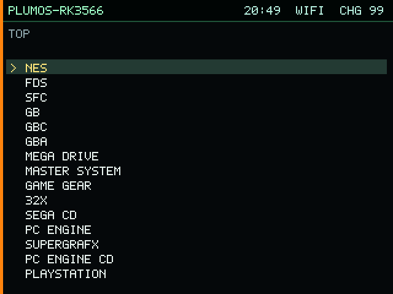
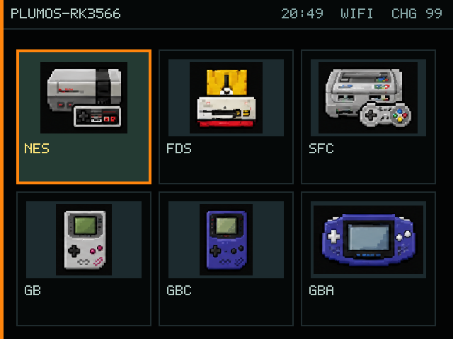
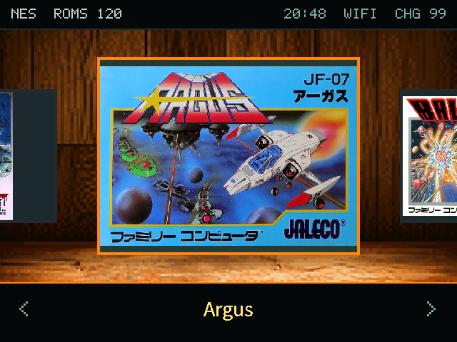

  

  

| Text mode | Graphic mode | Gallery mode |
| :---: | :---: | :---: |
|  |  |  |

# plumOS-RK3566

plumOS-RK3566 is SD-boot Linux firmware for RK3566 handhelds. The common SD image includes a frontend, RetroArch, PicoArch, and standalone emulators for tested Anbernic and Powkiddy devices.

## Documentation

- [User manual](docs/user/README.md)
- [Developer guide](docs/developer/README.md)
- [MIT License](LICENSE) · [Third-party licenses](THIRD_PARTY_NOTICES.md)
- [日本語](README.ja.md)
